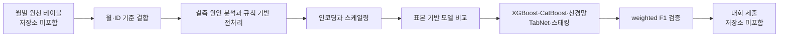

# 신용카드 고객 세그먼트 분류

[English](README.md) · [사례 연구](PORTFOLIO.ko.md)

DACON(국내 데이터 분석 경진대회 플랫폼) 신용카드 고객 세그먼트 분류 대회 데이터로, 고객·신용·매출·청구·잔액·채널·마케팅 월별 테이블의 857개 컬럼(상당수가 대부분 비어 있음)을 사용해 신용카드 고객을 다섯 세그먼트(A–E)로 분류합니다.

**왜 중요한가.** 세그먼트는 고객에게 어떤 카드 상품과 캠페인을 제안할지를 정하지만, 클래스 분포가 극단적으로 치우쳐 있습니다. 학습 데이터 2,400,000행 중 E가 80.1%이고 A와 B는 합쳐도 0.05% 미만입니다. 컬럼마다 결측 원인도 달라 결측 처리 방식 자체가 모델링 판단입니다.

**결과.** 학습 데이터에서 뽑은 20,000행 평가 표본에서 CatBoost + Logistic Regression + MLP(다층 퍼셉트론) 스태킹은 weighted F1 0.8936, CatBoost 단독은 0.8893을 기록했습니다. 항상 다수 세그먼트를 예측하면 0.7026입니다. private 리더보드 점수는 0.6251(58위·상위 25%)이며 평가 조건이 다릅니다.

## 데이터

월별 고객 기록 기준 학습 2,400,000행, 테스트 600,000행이며, 월별 도메인 테이블 결합 후 857개 컬럼, 다중 클래스 `Segment` 타깃입니다. 학습 세그먼트 분포는 E 1,922,052, D 349,242, C 127,590, A 972, B 144입니다. 원본 데이터는 포함하지 않았으며 대회 출처 링크는 `data/data`에 있습니다.

## 접근 방식



- **데이터 결합:** `src/baseline_xgb.py`가 월별 테이블을 도메인별로 이어 붙이고 월과 `ID` 기준으로 left merge합니다.
- **결측 분석:** `src/missing_mechanism_analysis.py`가 결측률을 계산하고 규칙 기반 채움과 multi-output random forest 대체를 실험합니다.
- **피처 준비:** 결측률 50% 이상 컬럼은 제거하고, 20~50%는 모델 기반으로 처리하며, 20% 미만은 `Unknown` 범주를 씁니다. 로그 변환과 표준화를 적용합니다.
- **모델 비교:** 2만 건 표본에서 CatBoost, Logistic Regression, XGBoost, Random Forest, DNN/MLP/CNN(심층·다층·합성곱 신경망), TabNet, 여러 스태킹 구성을 비교합니다.

설계 선택과 버린 대안: [PORTFOLIO.ko.md](PORTFOLIO.ko.md#주요-결정).

## 결과

| 실험 | F1 | 평가 맥락 |
|---|---:|---|
| 항상 E 예측(참고) | 0.7026 | weighted F1, 2만 건 평가 표본(클래스 분포로 계산) |
| Baseline XGBoost | 0.607 | public 리더보드 |
| 결측 인지 XGBoost | 0.625 | public 리더보드 |
| TabNet | 0.8285 | weighted F1, 2만 건 평가 표본 |
| CatBoost | 0.8893 | weighted F1, 2만 건 평가 표본 |
| CatBoost + Logistic Regression + MLP 스태킹 | **0.8936** | weighted F1, 2만 건 평가 표본 |

실험 요약(`reports/실험요약.md`)의 대회 점수는 public **0.64636**(75위), private **0.6251**(58위·상위 25%)입니다. CatBoost와 TabNet 값은 노트북 출력에, 스태킹 값은 실험 요약과 아래 그림에 있습니다. 표본 F1은 모두 같은 20,000행 표본에서 계산했습니다(실험 요약은 TabNet을 "test", 나머지를 "validation"으로 표기).


*그림. 2만 건 평가 표본의 weighted F1입니다. 축이 0.82에서 시작해 차이가 실제보다 커 보이며, 다수 세그먼트 기준값(0.7026)은 그림 왼쪽 밖에 있습니다.*

## 실행

이식 가능한 스크립트는 데이터 없이 입력 인자를 확인할 수 있습니다.

```powershell
pip install -r requirements.txt
python src\preprocess_missing_features.py --help
python src\missing_mechanism_analysis.py --help
python src\preprocess_overview.py --help
```

대회 파일을 [`research/RUN_MANIFEST.md`](research/RUN_MANIFEST.md)의 설명대로 배치하면 `python src\preprocess_missing_features.py`가 결측 인지 기본 CSV를 만듭니다(`--drop-threshold` 기본값 0.50 이상인 컬럼 제거). 2만 건 모델 비교는 출력과 함께 `notebooks/train_eval_20k.ipynb`에 있습니다.

## 한계

- 표본 F1(약 0.89)과 리더보드 점수(약 0.6)는 평가 조건이 다르며, 리더보드 지표 정의는 기록되지 않았습니다.
- 리더보드 점수는 실험 요약의 기록이며, 제출 파일과 리더보드 export는 포함하지 않았습니다.
- 표본은 고객이 아닌 월별 행 단위로 뽑아, 같은 고객이 학습·평가 표본에 함께 들어갈 수 있습니다.
- weighted F1은 E 세그먼트가 좌우하며, 평가 표본에는 A가 11행, B가 0행입니다. 클래스별 F1과 혼동행렬은 보관하지 않았습니다.
- 표본 F1은 2만 건 표본 결과이며 전체 데이터 재실행이 아닙니다.
- 원래 패키지 버전이 기록되지 않아 결과를 그대로 재현할 수 없습니다.
- 내보낸 `src/train_eval_20k.py`는 노트북 셸 명령이 남아 있어 스크립트로 실행되지 않습니다.

## 저장소 구성

```text
.
├── src/                         # 내보낸 Colab 전처리·학습 스크립트
├── notebooks/                   # 출력이 저장된 노트북(결과의 근거)
├── reports/실험요약.md           # 실험 요약과 점수
├── images/model_f1_comparison.png
└── data/                        # 데이터 출처 링크만 있는 자리표시자
```

## 문서

- [포트폴리오 사례 연구](PORTFOLIO.ko.md)
- [프로젝트 리뷰](docs/PROJECT_REVIEW.md)
- [아키텍처](docs/ARCHITECTURE.md)
- [CV 문장](docs/CV_BULLETS.md)
- [실행 매니페스트](research/RUN_MANIFEST.md)
